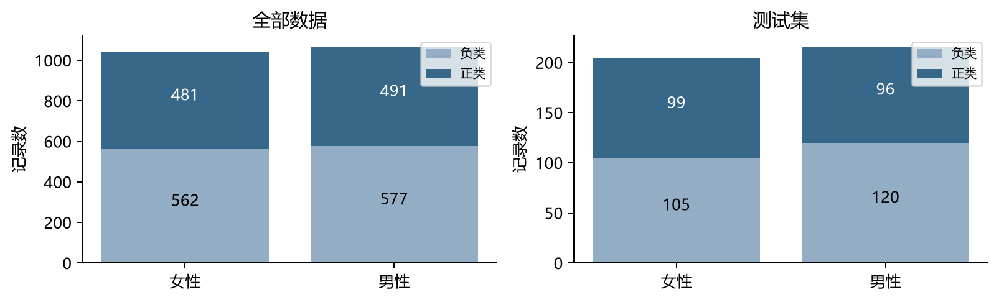
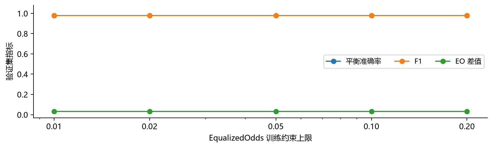
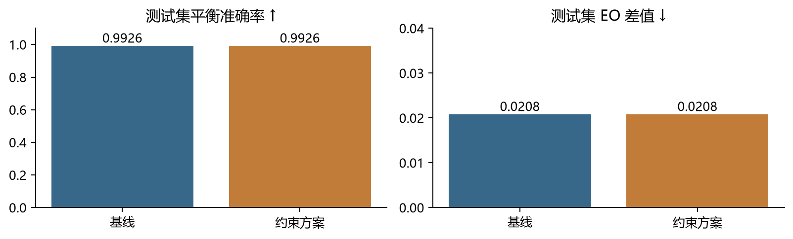
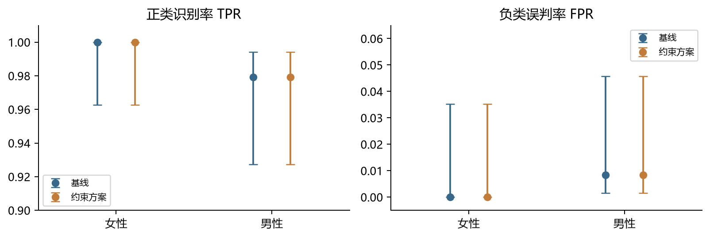
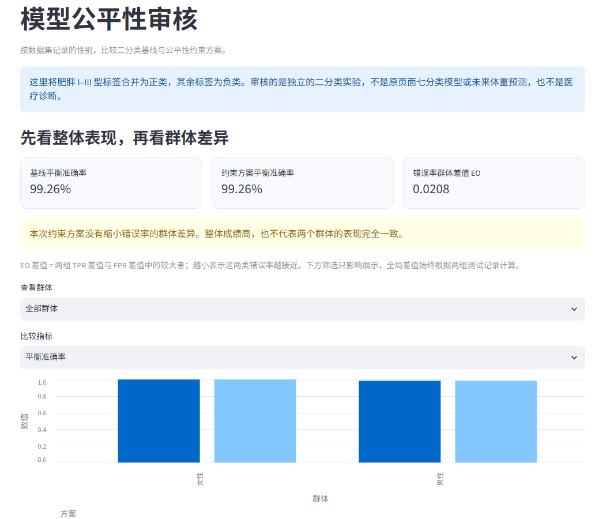

# 健康数据模型公平性分析报告

本实验在 WeightTrend 项目上增加性别公平性审核。基线与约束方案的测试集平衡准确率均为 99.26%，EO 差值均为 0.0208。本次改进尝试没有改变测试预测，不能据此宣称已经改善公平性。

## 一 审核对象与分组

使用 UCI 544 的 2111 条记录。原七分类标签中，肥胖 I、II、III 型合并为正类；体重偏低、正常体重、超重 I、II 级合并为负类。负类不等于健康，正类也不是医疗诊断。目标是检查该标签判定在数据集记录为 Female 和 Male 的人群中是否存在错误率差异。

本次完成基础任务，只审核性别。分组直接采用原数据字段，不从姓名或外貌推断；数据没有其他性别身份编码，不能据此评价其表现。可能受影响的是依赖页面理解自身输入与模型标签关系的使用者；漏判可能带来错误的安心，误判可能造成不必要的担忧。

| 划分与群体 | 样本量 | 正类 | 负类 | 正类比例 |
| --- | --- | --- | --- | --- |
| 全部 / 女性 | 1043 | 481 | 562 | 46.12% |
| 全部 / 男性 | 1068 | 491 | 577 | 45.97% |
| 训练 / 女性 | 629 | 284 | 345 | 45.15% |
| 训练 / 男性 | 641 | 299 | 342 | 46.65% |
| 验证 / 女性 | 210 | 98 | 112 | 46.67% |
| 验证 / 男性 | 211 | 96 | 115 | 45.50% |
| 测试 / 女性 | 204 | 99 | 105 | 48.53% |
| 测试 / 男性 | 216 | 96 | 120 | 44.44% |

图 1 两组总体规模接近，全部数据正类比例约 46%，没有明显的性别数量失衡。测试集各组都有至少 96 条正类和 105 条负类，可计算错误率，但记录数量不等于独立受试者数量。

<!-- pagebreak -->

## 二 实验设计与验证集选择

沿用原项目的 1270/421/420 划分，完全重复的特征记录作为一组分配，实测未跨集合。原数据无用户编号，无法按用户划分。字段映射固定，不学习全体数据的类别或阈值；本实验无缺失值、不按全量 IQR 删除记录。StandardScaler 只在训练集拟合，验证与测试只调用 transform。

为使用二分类 EqualizedOdds 约束，另训逻辑回归基线（C=1，max_iter=3000），保留全部 19 维输入，包括性别与年龄。约束方案使用同一种支持 sample_weight 的分类器。它与原型七分类随机森林是不同实验，不把两者成绩直接比较，也不把删除敏感字段当成公平性证据。

ExponentiatedGradient 的优化参数 eps 固定 0.01、max_iter=50；改变的是 EqualizedOdds 的 difference_bound。该约束比较同一真实标签内各组与整体的预测正类率偏差，与报告中组间最大减最小的 EO 指标不是同一上限。[2]

预设选型规则：验证集平衡准确率与 F1 相对基线下降均不超过 2 个百分点，在合格方案中优先取 EO 差值最小者；并列时依次取平衡准确率较高、约束上限较小者。2 个百分点只是课程实验的性能容忍线，不是临床可接受标准。

| 方案 | 约束上限 | 平衡准确率 | F1 | EO 差值 |
| --- | --- | --- | --- | --- |
| 基线 | — | 0.9798 | 0.9791 | 0.0317 |
| eo_0.01 | 0.01 | 0.9798 | 0.9791 | 0.0317 |
| eo_0.02 | 0.02 | 0.9798 | 0.9791 | 0.0317 |
| eo_0.05 | 0.05 | 0.9798 | 0.9791 | 0.0317 |
| eo_0.10 | 0.10 | 0.9798 | 0.9791 | 0.0317 |
| eo_0.20 | 0.20 | 0.9798 | 0.9791 | 0.0317 |

图 2 五种设置的验证指标完全重合，按并列规则锁定 eo_0.01。选型后不重新拟合训练加验证集，保留原训练模型，随后才进行测试评价。原项目此前已评价过这份测试划分，因此它并非从未被查看的外部盲测集；本次未据测试成绩调整模型或参数网格。

<!-- pagebreak -->

## 三 同一测试集上的改进前后对比

两种模型都在相同的 420 条测试记录上评价。Fairlearn MetricFrame 同时计算整体和分组指标，另用 equalized_odds_difference 与 demographic_parity_difference 汇总差值。约束方案调用 predict(random_state=42)，使用其随机混合策略，不额外给混合输出设阈值。

| 指标 | 基线 | 约束方案 | 变化 |
| --- | --- | --- | --- |
| 准确率 | 0.9929 | 0.9929 | +0.0000 |
| 平衡准确率 | 0.9926 | 0.9926 | +0.0000 |
| 正类 F1 | 0.9923 | 0.9923 | +0.0000 |
| EO 差值 | 0.0208 | 0.0208 | +0.0000 |
| DP 差值 | 0.0455 | 0.0455 | +0.0000 |

图 3 左侧指标越高越好，右侧越低越好；两轴量程不同，分别阅读。测试预测逐条一致，整体正确 417 条、错误 3 条。

| 方案与群体 | 平衡准确率 | F1 | 漏判率 FNR | 预测正类比例 |
| --- | --- | --- | --- | --- |
| 基线 / 女性 | 100.00% | 1.0000 | 0.00% | 48.53% |
| 基线 / 男性 | 98.54% | 0.9843 | 2.08% | 43.98% |
| 约束方案 / 女性 | 100.00% | 1.0000 | 0.00% | 48.53% |
| 约束方案 / 男性 | 98.54% | 0.9843 | 2.08% | 43.98% |

平衡准确率是正类召回率与负类召回率的平均；F1 是正类精确率与召回率的调和平均。本表 F1 不同于原七分类报告的宏 F1。女性组本次全部正确，男性组成绩稍低；不能用接近 99% 的整体准确率替代分组判断。

<!-- pagebreak -->

## 四 漏判 误判与不确定性

| 方案与群体 | TPR | FPR | 漏判 / 正类 | 误判 / 负类 |
| --- | --- | --- | --- | --- |
| 基线 / 女性 | 100.00% | 0.00% | 0/99 | 0/105 |
| 基线 / 男性 | 97.92% | 0.83% | 2/96 | 1/120 |
| 约束方案 / 女性 | 100.00% | 0.00% | 0/99 | 0/105 |
| 约束方案 / 男性 | 97.92% | 0.83% | 2/96 | 1/120 |

漏判率 FNR = FN / 正类数 = 1 − TPR；误判率 FPR = FP / 负类数。EO 差值取 TPR 组间差与 FPR 组间差中较大者。本次分别为 0.0208 和 0.0083，故 EO 为 0.0208。男性组的两条正类更容易在本次样本中被漏判，但尚不能推断性别导致了这些错误。

图 4 点为估计值，线为 95% Wilson 区间。为了看清接近边界的数值，左右轴分别放大到 0.90–1.01 和 −0.005–0.065。女性组 FPR 虽为 0，其区间上限仍为 3.53%；零错误不是零风险保证。缺少正类或负类时相关指标留空，分母少于 30 时标注不稳定；30 只是展示提醒，并非可靠性的充分条件。

| 数据行号 | 群体 | 错误 | 原七分类标签 | BMI |
| --- | --- | --- | --- | --- |
| 83 | 男性 | 漏判 | Obesity_Type_I | 30.66 |
| 244 | 男性 | 误判 | Overweight_Level_II | 28.93 |
| 488 | 男性 | 漏判 | Obesity_Type_I | 30.72 |

行号从处理数据第一条记录起计为 1，便于对照 features.csv；BMI 仅用于描述，原标签没有被重新计算。这三条错误在约束方案下均未修正。

测试集真实正类比例为女性 48.53%、男性 44.44%，相差 4.08 个百分点；预测正类比例相差 4.55 个百分点。因此 DP 差值的一部分与标签构成有关，不能仅凭正类预测率不同认定不公平。

<!-- pagebreak -->

## 五 为什么没有改善及其取舍

训练集基线 EO 差值为 0.0067；Fairlearn 约束实际检查的最大“组对整体”偏差为 0.0034，已低于最严格的 0.01。所测试的约束没有迫使模型明显改变判定边界，这是未改善结果的直接线索。选中模型的混合权重为 {'0': 0.0, '1': 1.0}，只有一个有效分量，100 个固定随机种子得到的测试 EO 均为 0.0208，没有观察到预测随机波动。

在这次实验里，原先成绩较低的男性组没有获得改善，女性组也没有被降低表现来换取更小差值。整体性能变化为零，满足预先设定的 2 个百分点容忍线；但零性能损失不等于有公平性收益。因此没有证据支持用当前约束方案替换基线，更不能说模型已对所有人公平。

对固定测试预测，按性别组内做 1000 次成对 Bootstrap，两模型平衡准确率、F1、EO 差值的变化区间均为 [0, 0]。原因是两模型逐条预测相同，重采样后差值必然为零；这不是“真实世界群体差异为零”的区间。它不包含重新训练、不同数据抽样、标签偏差和合成样本相关性带来的不确定性。

### 数据与结论的边界

1. UCI 数据来自墨西哥、秘鲁和哥伦比亚，约 23% 为直接采集、77% 为 SMOTE 合成记录。[1] 本项目没有可用于逐条排除合成样本的可靠标记。生成方法可能改变各组边界与错误分布，误差区间也依赖独立记录假设。
2. 肥胖等级与体重、身高高度相关，本次把相邻的三个肥胖等级合并，使任务比原七分类更容易。较高成绩可能主要反映标签规则，不能推断健康风险或未来减重效果。
3. 标签和问卷可能存在测量或定义偏差。EO 以标签为比较依据，标签有偏差时，较小 EO 也不等于没有伤害；不同类型错误的现实代价也可能不同。
4. 两组样本规模接近，但测试集只有三次错误，个别记录就能改变差值。没有按年龄或性别×年龄细分，也没有外部人群验证。
5. 审核使用全部 19 维输入。原型的七分类表单省略两个字段并作中位数填充，当前公平性结论不直接覆盖该输入简化方式。

后续可以在新的验证方案中探索更严格的约束、增加真实受试者数据并审核交叉群体。本次看过测试结果后没有继续改网格来追求更好数字；后续若根据这些发现改方案，应另留最终评价数据。约束是否改善不预设结论，应同时检查较差群体是否受益、另一组是否被拉低及错误成本是否可接受。

<!-- pagebreak -->

## 六 审核界面与用户理解评价

原型侧栏新增“模型公平性审核”，支持切换女性、男性或全部群体，选择平衡准确率、F1、TPR、FNR、FPR 和预测正类比例，查看同一测试集的基线与约束方案。全局 EO 不随展示筛选重新计算，以免把只显示一组误解为“差值为零”。

页面同时展示正负类数量、真实标签比例、错误率区间和验证集选型依据。说明使用“标签为正类却被判成负类”等短句解释错误；“理解自测”要求区分整体成绩与分组表现。原有体重管理页面仍可切回使用。

图 5 实际运行的审核页面。这里的浏览器和自动测试只验证功能，不构成真人理解测试成绩。

用户评价设四项任务：找到两组样本与标签比例；比较漏判和误判；判断约束是否改善；解释为什么整体约 99% 仍不能说明群体一致。测试指南和个人报告模板位于 user_test/；记录每项操作状态、真实用时、提示前后回答。T4先保留首次回答，再打开理解自测。

已收到P01、002、003的评测及后续补充，真人参与性质按用户确认登记。原记录、计时声明与代码核对意见分别保留。本节汇总能够从材料支持的发现，不把任务编号相同直接当作任务内容相同。

<!-- pagebreak -->

### 已收到的评测与理解情况

| 来稿 | 可保留的发现 | 评价限制 |
| --- | --- | --- |
| P01最新补测 | 分组、错误率与两方案判断正确。补充确认用手机分段秒表；T1、T2直接读取默认表格，T3、T4主体回答已覆盖。 | T1未切换群体、T2未切换FNR/FPR，两项指定交互部分完成。T4的130秒含自测，约90/40秒仅为拆分估计；已读源码和评估数据，不属于首次无材料暴露。 |
| 002最新补做 | 新稿记载女性、男性切换，以及FNR/FPR切换；样本、错误数及分母正确。已按同时展示比较两方案，判断没有改善。 | 已看参考答案。T1仍写不存在的敏感属性选择器和混淆矩阵卡片；T4记录位置、自测动作及计时方式待确认。99.26%需标为平衡准确率。 |
| 003 | 自由走查能指出整体成绩需要结合群体差异；对漏判和误判的含义有一次求助，建议让说明更靠近指标。 | 原T2把两类错误的较高群体分开描述，与男性两项均较高不符。T3/T4为扩展任务，后续补做为体重页面，未覆盖公平性四项任务。 |

对“整体准确率高是否说明各组表现一致”，P01最新补测已能用男性组集中出现三次错误作解释，指出女性零错误仍有区间不确定性；其较早来稿关于没有系统性偏见的判断另作历史保留，不当作本轮回答。002在已看答案后也能作出区分；003的自由回答提到了整体指标可能掩盖差异，但读取错误归属仍有问题。这些内容支持部分后续理解分析，不能合并为三人未经提示的首次理解正确率，也没有证据证明界面带来了理解提升。

P01用手机分段秒表，前三项42、115、88秒；T4的130秒含自测，完整模块375秒。首次回答约90秒、自测约40秒仅为估计，不将90秒填作实测；标准T4用时仍缺失。002最新自报94、72、81、112秒，合计359秒，声明T4停表后再自查；计时工具与部分步骤尚待确认，不称为已核验的四项标准总用时。P01早前545、281秒、002原估计值及410秒均另存；003的27分钟为估计，后续1270秒为体重任务，不跨轮次或任务平均。

按任务单的指定动作核对，P01的T1、T2部分完成，T3、T4主体操作与回答已覆盖，本轮完整覆盖2/4。它反映指定交互的覆盖情况，不是理解正确率或未经提示的首次独立完成率。P01已通过默认表格取得主要信息，说明信息获取与控件测试需要分别评价；补充的“若切换”说明不记为实际观测。主分组表实际为四行变两行（两个方案），下方样本表不随群体过滤。

三份材料已经收齐，但统一标准任务的完成率、无提示理解正确率和平均操作时间尚未形成。后续核对或补测应保留原始计时、首次回答和已有答案暴露，缺失字段保持缺失。此前体重原型反馈不替代公平性页评价。

来源与指标核对：544是UCI编号，官方为2111条、约23%直接采集和77%合成。[1] 标签比例差用99/204与96/216计算约4.08个百分点；原稿4.09%的说法另存。002将417/420写为99.26%，普通准确率实际约99.29%，99.26%为平衡准确率。EO取TPR/FPR差值中的较大者，本次恰为TPR差值，不宜简化为一般定义。负类不等于健康，标签不是医疗诊断。

<!-- pagebreak -->

### 改进建议、实施状态与评价局限

| 类型 | 根据反馈采取或建议的改进 | 当前状态与检验方式 |
| --- | --- | --- |
| 测试文档 | 将四项固定题干直接放进模板；标明task_sheet.md属于第一次作业；自由探索与补测另记。 | 已落实。后续收回记录时检查是否仍出现任务错配；现有材料不能证明错配已减少。 |
| 测试流程 | 将信息读取目标与必须验证的控件操作分开核查。P01直接从表格读数，绕过了两项指定切换。 | 指南原本已要求切换群体和FNR/FPR；本轮仍未执行。保留为执行核查或任务可见性问题，不把正确读数直接当成控件测试完成。 |
| 界面 | 说明样本统计表由“数据范围”控制，帮助读者找到错误数和分母。P01建议补计数列，但当前表已含漏判数和误判数。 | 保留为计数可发现性问题，不重复新增已有列。后续应观察使用者能否自行找到并解释。 |
| 界面 | 让两方案同时展示、数值可能相同的说明更醒目，明确自测入口。P01对原因解释的建议应结合训练约束诊断。 | 当前没有方案切换控件，也不是后处理阈值实验，不能照抄建议中的机制解释。已有区间说明，新的视觉调整尚未实施或复测。 |
| 模型评价 | 增加独立真实人群数据，检查错误集中在哪些记录和群体；新约束仍在验证集选择。 | 本次男性三条错误均未改善。外部验证与交叉群体审核属后续工作，不能用界面优化替代模型证据。 |

本轮评价只有三个代号，测试经验和参考答案暴露不一致；部分记录来自自由探索，部分操作无法对应指定版本。反馈可用于定位术语、筛选范围和测试材料的问题，但不足以比较不同界面的易用性，也不能推广到没有技术背景的所有使用者。

后续应在同一运行版本上补齐四项任务的实际操作，先保存首次回答再帮助。已有走查者按后续测试记录；如需评价初次理解，应另邀请未看过答案的使用者。收回材料后分别汇总操作完成、理解和用时，不用模型99%的成绩代替用户评价。

<!-- pagebreak -->

## 七 复核文件与来源

代码包保留训练、验证、测试的中间结果，报告图表由同一批 CSV 生成。逐条预测中的 row_id 为 features.csv 的零起始索引，案例表展示时加 1；性别编码为 Female=0、Male=1。

| 文件 | 可复核的内容 |
| --- | --- |
| data/processed/features.csv | 原始标签、编码特征和固定划分 |
| reports/fairness/group_counts.csv | 每组规模、正负类数和标签比例 |
| reports/fairness/selection.json | 参数网格、性能容忍线、验证集选型和数据哈希 |
| reports/fairness/validation_comparison.csv | 基线和五种约束强度的验证结果 |
| reports/fairness/test_group_metrics.csv | 整体与分组性能、混淆计数和 Wilson 区间 |
| reports/fairness/test_predictions.csv | 基线与约束方案在同一测试样本上的判定 |
| reports/fairness/constraint_diagnostics.json | 训练时组对整体偏差与最终混合权重 |
| reports/fairness/test_summary.json | 测试指标、固定模型与成对 Bootstrap 差值区间 |

复现实验依次运行 python -m src.fairness train、python -m src.fairness evaluate、python -m src.fairness_report。详细环境和启动步骤见《公平性实验运行说明》。为避免覆盖原结果，建议在另一个解压副本中操作。

### 参考资料

[1] UCI 544，Mendoza Palechor 与 De la Hoz Manotas，2019。https://doi.org/10.24432/C5H31Z 。许可 CC BY 4.0，本项目进行编码、划分及模型训练。

[2] Fairlearn 0.13 EqualizedOdds 文档：https://fairlearn.org/v0.13/api_reference/generated/fairlearn.reductions.EqualizedOdds.html 。MetricFrame 文档：https://fairlearn.org/v0.13/api_reference/generated/fairlearn.metrics.MetricFrame.html 。

所有分组 CSV、逐样本预测、验证集选择与图表保存在代码包 reports/fairness/。AI 辅助资料查找、文档整理和代码核验；实验数字来自实际运行，未补写真人测试。本实验仅用于课程学习，不作为医疗诊断依据。
