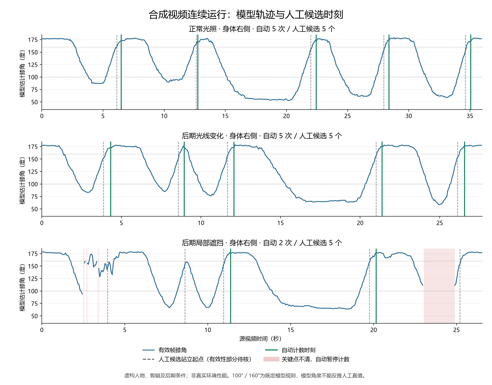

# 深蹲计数三条件合成视频测试

> 本页保留2026-11-20连续运行与候选匹配的历史口径。2026-11-25已按用户委托完成[AI辅助判读及逐次核对](../submission_20261121/assisted_review.md)，保留七项无法判断与误差范围，提交索引见[最终材料](../submission_20261121/README.md)。原模型会话与人工候选时间不改写。

2026-11-20以固定的`squat-counter-v2`和真实MediaPipe CPU模型连续处理三段来稿。身体右侧自动计数为5、5、2；与用户补充的15个候选站立时刻逐次匹配，分别匹配5、5、2个。浅蹲是否满足既定深度/稳定时间、遮挡中估计时刻及连续动作边界尚未全部裁定，因此以下未匹配数不直接作为正式误计或漏计。

输入为AI生成的虚构人物，经过拼接；调光和深色色块遮挡均为后期效果。它们是合成素材的受控测试，不能用于宣称真实学生或真实环境下的识别准确率。三个输入的基础动作不同，也不是只改变一个条件的配对因果实验。

## 来源与标注

[原始annotations.json](../../../user_test/squat_synthetic_annotations_received.json)逐字节保存，SHA256为`b8dfd4b76f25e39eb53f41b2083843882e4a7f2de11405b202bb05caee642aaa`。其声明为Grok Imagine图生视频，同一站立首尾帧，AI助手按10fps联系图目测并辅以头顶高度曲线标注。原始生成图片出处及公开影像许可未提供；视频和25份来稿中的联系图等原件只保存在本地归档，不推送GitHub。

用户随后确认已有人工复核，并另发[人工补充转写](../../../user_test/squat_synthetic_human_reference.txt)；[结构化候选时刻与疑点](../../../user_test/squat_synthetic_human_reference.json)与原AI标注分开。用户提供的“头顶接近站立高度、膝盖接近伸直”完成时刻，不自动证明下蹲≤100°和站立≥160°各稳定300毫秒。逐次角度/持续时长复核表及人工时刻精度未提供；不把原AI自述±0.1秒写成人工复核精度。

| 输入 | 实测时长 | 帧数与尺寸 | SHA256 |
| --- | --- | --- | --- |
| normal_light.mp4 | 36.000秒 | 864帧，1280×720，24fps | `ef30e30d4b61fd52df7d63a3dbdd3ba57bc03a0dfa5417d995569dd45dfeb273` |
| light_change.mp4 | 27.666667秒 | 664帧，1280×720，24fps | `f7b31a9a80336a015f339ce5bec88e8d60e1ef0439a29ae58046a29c2d59e188` |
| occlusion.mp4 | 26.541667秒 | 637帧，1280×720，24fps | `6f52693197d3a76e991323c00d53fd5435729eb1ec60a69e5f139281bc719178` |

## 连续运行与左右侧对照

Windows本机Chrome 150.0.7871.127，无头浏览器，MediaPipe Tasks Vision 0.10.32，Pose Landmarker Lite float16/1，CPU；模型SHA256保持`59929e1d1ee95287735ddd833b19cf4ac46d29bc7afddbbf6753c459690d574a`。运行代码为`45202c2`的应用，模型与全部计数阈值未改。软件渲染回调估计延迟受本机运行环境影响，不代表之前Debian同学的实测延迟。

先按默认左侧完整运行三段，发现全部帧未通过关键点检查后补做全部右侧。保留六次原始导出及元数据；右侧是诊断后追加的设置，不冒充事先固定的唯一设置，也不只发布较好的一侧。每次从头1倍速播到自动结束，无手动暂停、继续或计数修正，未填写同学反馈。每次8项运行完整性检查通过，未记录页面错误，处理帧最大间隔均小于500毫秒。

| 输入与选择 | 自动计数 | 通过关键点检查的处理帧 | 原会话 |
| --- | ---: | ---: | --- |
| 正常光照，左侧 | 0 | 0 / 569 | [导出](normal_light/session.json) · [运行元数据](normal_light/run_metadata.json) |
| 正常光照，右侧 | 5 | 572 / 572 | [导出](normal_light_right/session.json) · [运行元数据](normal_light_right/run_metadata.json) |
| 光线变化，左侧 | 0 | 0 / 436 | [导出](light_change/session.json) · [运行元数据](light_change/run_metadata.json) |
| 光线变化，右侧 | 5 | 437 / 437 | [导出](light_change_right/session.json) · [运行元数据](light_change_right/run_metadata.json) |
| 局部遮挡，左侧 | 0 | 0 / 422 | [导出](occlusion/session.json) · [运行元数据](occlusion/run_metadata.json) |
| 局部遮挡，右侧 | 2 | 390 / 423 | [导出](occlusion_right/session.json) · [运行元数据](occlusion_right/run_metadata.json) |

左侧正常光照569帧、光线变化436帧均为`low_visibility`；左侧遮挡为420帧低可见度、2帧未识别人形。这个结果说明设置与关键点可靠性影响本次识别，不能把0次直接解释成“没有动作”。右侧遮挡输入中3帧未识别人形、30帧低可见度。通过检查的帧数只反映模型是否接受该帧，不是预测正确率；遮挡时模型有时仍输出高可见度点，也不能据此认为被遮挡部位实际可见。

## 人工候选事件的逐次匹配

使用运行前已固定的1200毫秒窗口，复用现有评价工具的一对一最大匹配、再最小时间差算法。直接比较原始自动事件，不用手工修正总数。对于全部候选均被最终确认为有效动作的假设，未匹配自动事件数才对应误计，未匹配候选数才对应漏计；当前保留条件表述，不计算“5/5准确率”。

| 右侧输入 | 候选数 | 自动数 | 匹配数 | 未匹配自动数 | 未匹配候选数 | 候选到反馈估计中位数 / P95 | 样本数 |
| --- | ---: | ---: | ---: | ---: | ---: | --- | ---: |
| 正常光照 | 5 | 5 | 5 | 0 | 0 | 467.5 / 482.2毫秒 | 5 |
| 光线变化 | 5 | 5 | 5 | 0 | 0 | 446.8 / 485.5毫秒 | 5 |
| 局部遮挡 | 5 | 2 | 2 | 0 | 3 | 451.1 / 463.1毫秒 | 2 |

左侧各5个候选均未匹配，没有反馈时间样本，中位数和P95保留`null`，不填0。上述右侧时间为“源帧时间加处理至后续渲染回调耗时，减人工候选起点”，含规则确认，不是单独的推理耗时，也不是光电测量。各组只有2至5个匹配样本，P95是这几个数值的插值描述，不能代表稳定的尾部延迟。正常光照第2个候选差值只有166.2毫秒，提示人工目测站立定义与模型阈值起点可能不同；不能因这个值小于300毫秒就认定稳定规则失效。全部逐次匹配、原始数值、负值检查和条件假设见[机器摘要](summary.json)，不只核对最终总数。

| 遮挡输入候选 | 结果与证据 |
| --- | --- |
| 第1次，3.96秒 | 未匹配。人工说明是遮挡中估计；模型在2.494、2.682、3.369秒的处理帧未识别人形并清除待确认动作。遮挡中深度和准确完成时刻仍需独立裁定。 |
| 第2次，8.63秒 | 未匹配。用户说明尚未完全站直，8.79秒又下蹲；模型从8.188至9.314秒的有效帧始终位于100°至160°中间区间，未达到站立确认。模型轨迹是诊断线索，不反过来当人工真值。 |
| 第3次，10.96秒 | 匹配自动事件11.375502秒；与前一次连做时只确认了这次站立，不能仅凭“候选有两个”认定两次都应计入。 |
| 第4次，19.75秒 | 匹配自动事件20.145908秒；保持区间15.3至18.7秒内没有重复计数。16.50秒存在剪辑，保留这一限制。 |
| 第5次，25.21秒 | 未匹配。23.021至24.833秒的30个处理帧低可见度，清除了待确认动作；恢复可见后的站立不能拼接成旧动作完成。是否为满足完整规则但受遮挡漏识别的动作，需要人工深度/持续时长参照。 |

若最终人工判定第2次不满足站立300毫秒，仅排除这一候选：右侧参照从5变4，仍匹配2，未匹配候选从3变2，未匹配自动数仍0。[摘要](summary.json)同时保留这个敏感性分析和原五候选结果；没有静默删去难例。其他浅蹲、遮挡估计未因此自动变为已确认有效。

正常光照第3次保持16.8至20.5秒、光线变化第4次保持16.6至19.7秒、遮挡第4次保持15.3至18.7秒，三段右侧运行在相应保持区间均未产生重复事件，随后分别只记录一次起身完成。这支持本组输入下的“保持不重复”行为，不代表已通过所有真实动作情况。



[SVG矢量图](right_side_traces.svg)保留可缩放图表。虚线是人工候选起点、绿线是自动事件，红色区域是关键点检查不通过的处理帧区间；图中的模型角度不能用来确认独立人工标签。

## 待人工裁定与提交状态

保留全部15个候选。对正常光照第1、2次、光线变化第1至3次，补充是否达到约定下蹲深度并保持300毫秒；对遮挡第1次，注明有效性及时间不确定范围；对遮挡第2、3次，明确按照300毫秒站立规则应计几次。若候选最终判定无效，它附近的自动事件也须重新匹配，不能只减少漏计而不检查新增误计。有效性应从源视频独立复核，不能抄用本次MediaPipe角度作真值。

当前已完成三条件合成视频的实际模型运行、候选匹配、时间估计与失败线索；`formal_recognition_metrics`保持`null`，待逐次规则裁定后再导出正式误计/漏计与反馈延迟。既有三名同学的v1操作记录、v2同片段技术前后对照均保留，本轮不增加真人测试人数。真实场景泛化仍需真实素材验证。

## 本地课程演示

已另外录制约两分钟的MP4演示，包含正常输入实际CPU识别、保持不重复、暂停继续、遮挡提示、补记与撤销练习、合成摄像头状态及关闭入口。片头和持续字幕说明AI素材、后期效果、自动操作与非真人测试；补记/撤销明确标为控件练习，不当作实际计数错误判定。

演示文件位于本机`commit/squat_synthetic_v2_intake_20261120/demo_reviewed/squat_counter_v2_demo_synthetic.mp4`，仅本地保留，可另随课程材料提交，不包含在GitHub克隆中。[演示元数据](demo_manifest.json)记录时长、编码、大小、SHA256和会话边界。演示会话包含暂停或修正，与前述六次连续运行分开，不能重新加入识别统计；Chromium合成摄像头只用于验证开启/关闭入口，不代表实际摄像头识别效果。

## 复现与验证

应用按[启动说明](../../../user_test/squat_counter_quickstart.md)启动。开发期需另装Playwright及Chrome；分析图另需Matplotlib与ffprobe。这些不加入应用运行依赖。每次输出到空目录，脚本拒绝覆盖已保存会话。

```text
py -3.13 -B scripts/run_squat_video_session.py --url http://127.0.0.1:8534 --video D:/Download/squat_v2_videos/normal_light.mp4 --output reports/squat_counter/synthetic_v2/normal_light --side left
py -3.13 -B scripts/run_squat_video_session.py --url http://127.0.0.1:8534 --video D:/Download/squat_v2_videos/normal_light.mp4 --output reports/squat_counter/synthetic_v2/normal_light_right --side right
python -B scripts/analyze_squat_video_sessions.py --media-dir D:/Download/squat_v2_videos
```

另两段同样分别执行左右两侧。已保存的目录不会被重跑覆盖，复测请用新的输出根目录，并通过分析脚本`--output`指定。本轮六次运行共48项完整性检查通过；相关Python测试14项、Node规则测试9项通过，图表已目视检查。应用、启动依赖及旧作业材料未改，本轮未重跑完整81项、两入口全套浏览器验收或Debian启动；[核验记录](verification.json)补充文件哈希与保留检查。
