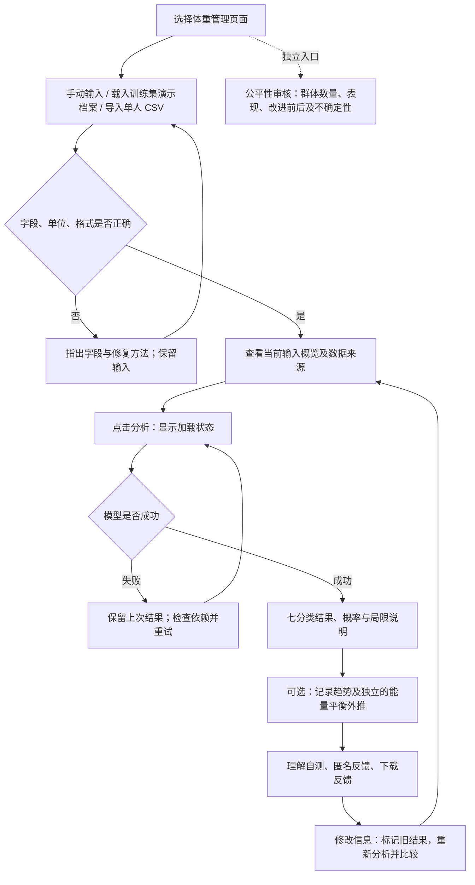

# WeightTrend 交互设计与验证报告

日期：2026-10-19。范围：在既有七分类模型及性别公平性审核结果上完善界面，不重新训练或改变冻结评价数据。

## 1. 用户与场景

**主要用户：大学生。** 场景是课堂中使用笔记本完成一次体重档案录入、结果理解和修改重算。下表为本轮设计假设，尚未通过新版真人访谈验证。

| 用户 | 使用目标与习惯 | 主要困难 | 设计依据 |
|---|---|---|---|
| 第一次接触模型的大学生 | 希望迅速完成任务，习惯中文表单与现成模板 | 不熟悉英文编码、概率含义和单位 | 中文选项、米/kg 标注、CSV 模板、结果旁直接解释 |
| 已有记录的大学生 | 希望复用文件，比较修改前后结果 | 重复输入；不知道结果是否已经更新 | 单人 CSV 导入、当前输入概览、待分析提示、提交快照及比较表 |
| 使用键盘或小屏幕的学生 | 需要清楚的标签、焦点和文字替代 | 小字、图表只靠颜色、表格编辑负担 | 原生控件、44 px 按钮、可见焦点、趋势文字与数据表；趋势可取消 |
| 课程审核或管理人员 | 需要检查群体表现、错误及约束效果 | 把整体高成绩或零错误理解成完全公平 | 独立审核页、分组数量与错误分母、区间、前后差异及局限 |

大学生属于交互设计对象，不代表模型已对中国大学生完成外部验证。输入性别只支持训练数据的 Female/Male 编码，不能代表全部性别身份；不愿提供个人信息的用户可用演示档案完成课堂操作。

## 2. 核心任务流程



可直接查看 [流程图 SVG](task_flow.svg)。输入概览随编辑更新；只有点击分析按钮才运行模型。结果明确采用提交时的快照，反馈和审核页切换不触发隐式重新预测。

## 3. 页面与交互实现

### 输入和概览

- 保留原型的 14 个采集字段，分为身体信息、饮食、运动与生活方式；没有新增健康评分。
- 数值控件标明单位与边界；身高用米，体重用 kg，FAF 是 0–3 问卷分值，不是每周运动次数。
- CSV 仅接收 UTF-8、最多 1 MB、表头加一行个人数据。缺列、空值、重复表头、类别错误、单位造成的越界均返回字段提示；失败不覆盖现有表单。
- 模板保留英文编码以匹配模型。成功导入后先核对表单，再明确点击分析；额外列会提示忽略。
- 每日饮水量 CH2O 和设备时间 TUE 不采集，始终取训练集中的中位数。导入文件提供这两列也不会改变此口径。
- 概览显示当前档案体重、身高和运动分值。默认档案注明模拟，训练集演示档案注明非个人记录，CSV 注明来源真实性未核验；编辑混合档案提醒逐项核对。
- 体重日志默认是模拟数据，使用自己的记录时需声明来源；趋势分析可取消，没有日志也能运行分类。
- 根据反馈，入口直接说明“中文表单填写 / CSV 导入”，给出身高和体重示例及直达表单链接。
- 第三轮增加类别编码对照表；导入值与示例模板完全一致时显示示例说明，其他内容仍标为用户提供，不根据文件名推断来源。

### 分析、解释与反馈

结果显示七分类标签、各类别概率、最高与第二高概率差。概率未校准，不是正确率、患病风险、减重成功率或综合健康评分。整体特征重要性不是个体因果解释。既有横断面模型不能验证未来体重预测。

趋势以日志最新体重起算，分类使用档案体重；两者不一致时提示。记录与外推分别标明类型，提供文字方向、数值和数据表，不能仅凭曲线颜色理解。未来 90 天曲线沿用独立解析模型的恒定能量差假设，不添加无依据的置信区间或个人处方。

修改任一档案字段、日志、摄入热量或趋势开关后，立即显示“输入已修改，请重新分析”。重新分析成功才替换快照；比较表同时显示类别/概率和改变的输入。反馈操作会保留分类、比较和趋势，反馈 JSON 绑定该次分析时间。

反馈包括 1–5 分操作容易程度、一道分类含义自测和可选建议。未选择必填项时保留内容并提示补齐；反馈只存在会话内，可主动下载，不自动收集姓名或向外部发送。

依据反馈增加顶部结果摘要，并列分类结论、分类档案体重与趋势日志体重；前后对比提前，并用文字标注类别是否改变及已修改字段。重要性表使用中文表头，补充相对值、中位数和横断面的短解释。摘要可直达反馈；错误区可返回热量或日志输入，保存反馈后明确下一步下载。

第三轮将概率图改为横向降序，与概率表同序，坐标与提示使用百分比。前两类概率和百分点差同时列出，解释接近时单一标签容易随输入变化，不设置未经验证的风险阈值。比较区显示最近两次成功提交的时间及基准更新规则。趋势图使用中文轴、实线/圆点记录、虚线外推和起点标记，减少仅靠颜色辨认的负担。

### 独立公平性审核

此页读取 `reports/fairness/` 冻结结果。其任务是将肥胖 I–III 型合并为正类的二分类实验，使用完整 19 维输入；不直接代表原型简化输入后的七分类公平性，也不代表未来外推公平性。

当前测试集女性 204 条、男性 216 条；女性本次没有错误，男性漏判 2 次、误判 1 次。基线与约束方案的平衡准确率均为约 99.26%，EO 差值均为约 0.0208；本次方案没有缩小差异。页面同时展示前后数值、正负类分母、错误数量、Wilson 区间与样本代表性限制。

新增平衡准确率与 F1 的通俗说明、顶部整体卡片保持不变的说明，以及群体筛选对各表的影响范围。仅审核了数据中二元性别，没有据一个指标宣称完全公平。

第二轮将十三列分组表分层：默认展示方案、群体、样本量、漏判数、误判数、漏判率和误判率，完整指标保留在展开详情中；错误率用百分比展示，EO 0.0208 解释为约 2.08 个百分点的群体差值。

第三轮将审核图、详情、区间和样本比例统一为百分比；EO、DP 及训练约束差值使用百分点，保留原始小数的解释，下载的冻结数据不变。增加识别率例子、区间及 Wilson/SMOTE 的短解释。

## 4. 状态、恢复与无障碍

| 状态 | 可见反馈 | 恢复方法 |
|---|---|---|
| 首次进入 | “尚无分析结果”，示例来源明确 | 填写/导入后分析 |
| 模型加载或预测中 | 原生加载提示及动作名称 | 等待完成；失败显示恢复提示 |
| 档案 CSV 有误 | 指出缺列、空值、重复表头或非法字段 | 按模板修正再导入；原输入保留 |
| 日志为空/无效或摄入为零 | 分类仍可完成；趋势说明未生成 | 补足两条有效记录，或取消趋势 |
| 输入已改但未提交 | 文字警告，旧结果带提交时间及来源 | 点击分析 |
| 模型预测失败 | 保留输入和上次成功结果 | 检查模型、依赖，点击分析重试 |
| 模型或文件缺失 | 缺失文件与生成命令 | 生成后点击检查或重新加载 |
| 审核文件不可读 | 错误文字与重新读取按钮 | 恢复冻结资料后重试 |
| 反馈未填全 | 说明待填写项目 | 补齐后保存 |

原生控件保留文本标签和浏览器键盘语义；Tab/Shift+Tab 移动，方向键选择，Enter/空格激活。按钮设最小 44 px 高度与明确焦点；主按钮使用深蓝配白字，辅助说明加深文字颜色。颜色状态均配有文字；概率表、趋势数据表与文字摘要作为图表替代。

本轮为基础无障碍改进与自动回归，不宣称完成 WCAG 合规认证。完整屏幕阅读器体验、不同浏览器/主题和真实辅助技术用户仍需人工验证。

## 5. 模型接口和运行方法

在项目根目录运行：

```powershell
python -m pip install -r requirements.txt
python -m streamlit run app.py
```

本地已有模型时可直接运行。Git 克隆后模型为忽略的生成产物，需要先按 README 下载、预处理、训练及评价：

```powershell
python -m src.download_data
python -m src.preprocess
python -m src.train
python -m src.evaluate
```

只查看公平性页无需训练，选择侧栏“模型公平性审核”即可。公平性实验文件已入库，本轮不覆盖或重跑。

**接口是本地 Python 调用，无额外 HTTP API。** `parse_profile_csv(bytes, ranges)` 返回 `(profile, errors, notices)`；`validate_profile` 校验补全后的原始字段；`encode_features(DataFrame)` 产生固定顺序的 19 维特征。`app.predict_profile(model, clean)` 调用已训练 Pipeline 的 `predict` 与 `predict_proba`，按分类器 `classes_` 对齐概率列，返回以下字段：

| 字段 | 类型与含义 |
|---|---|
| label | str，七个英文标签之一，如 Normal_Weight |
| by_label | dict[str, float]，全部七类对应的概率，和约为 1 |
| top_probability | float，最高类别概率 |
| second_probability | float，第二高类别概率 |

前端使用 `models/final_model.joblib`、`model_metadata.json`、`raw_ranges.json`，输入填充与先前模型评价口径保持一致。

模型接口最小调用示例：

```python
import json
import joblib
import pandas as pd
from pathlib import Path
from src.config import IMPUTED_NUMERIC_FEATURES
from src.preprocess import encode_features
from src.validation import validate_profile

ranges = json.loads(Path("models/raw_ranges.json").read_text(encoding="utf-8"))
row = pd.read_csv("data/sample/profile_template.csv").iloc[0].to_dict()
for name in IMPUTED_NUMERIC_FEATURES:
    row[name] = ranges[name]["median"]
clean, errors = validate_profile(row)
if errors:
    raise ValueError(errors)
model = joblib.load("models/final_model.joblib")
features = encode_features(pd.DataFrame([clean]))
label = model.predict(features)[0]
probabilities = dict(zip(model.named_steps["classifier"].classes_, model.predict_proba(features)[0]))
```

## 6. 验证证据与提交索引

- 修改前基线：34 项自动测试通过；第二轮 54 项通过；第三轮 55 项通过，涵盖快照、趋势开关两种状态返回、热量恢复、图表格式与模型/公平性检查，详见[最新验证记录](iteration_3/verification.json)及 `tests/`。
- [浏览器回归记录](browser_checks.json)：实际 Chrome 自动操作，明确为自动化，不等同于真人任务成绩。
- 关键截图：[输入](01_input.png)、[导入错误](02_import_error.png)、[结果解释](03_result.png)、[待重算](04_stale.png)、[反馈](05_feedback.png)、[公平性](06_fairness.png)、[窄屏](07_mobile.png)、[趋势](08_trend.png)、[公平性分组表](09_fairness_groups.png)。均使用示例数据和自动操作，非真人健康记录。
- [用户测试与迭代](../../user_test/interaction_iteration.md)：证据核对、问题、前后差异、复测及新版首测。
- [体验反馈填写模板](../../user_test/真人测试填写模板.md)、[组织者指南](../../user_test/interaction_test_guide.md)与[记录表](../../user_test/interaction_records.csv)：当前纳入 002、003、004 三份任务记录；各轮版本、计时范围、完成及恢复状态分别保留。
- [002 报告](../../user_test/feedback_002.md)：六项体验反馈与随附自动化证据分开，脚本计时不作真人用时。
- [003 反馈整理](../../user_test/feedback_003_review.md)与[第二轮截图和回归](iteration_2/)：界面修改和技术验证，保留第一轮证据。
- [更新后复测对照](../../user_test/retest_comparison_20261019.md)及[复测记录表](../../user_test/retest_records_20261019.csv)：002、003 对同一新版的后续反馈，不新增参与者，不覆盖修改前记录。
- [004 原稿](../../user_test/feedback_004.md)、[反馈整理](../../user_test/feedback_004_review.md)及[证据目录](../../user_test/evidence_004/)：第二轮界面首测，保留六项用时、工具中断与恢复记录。
- 第三轮：32 项[浏览器检查](iteration_3/browser_checks.json)通过；最新[概率图](iteration_3/12_probability_chart.png)、[趋势图](iteration_3/13_trend_chart.png)、[区间说明](iteration_3/14_fairness_intervals.png)、[部分成功状态](iteration_3/15_partial_success.png)、[CSV 对照](iteration_3/16_csv_codes.png)，其余关键页面在[第三轮目录](iteration_3/)。旧截图保留作为修改前证据。
- 截图复现：启动 Streamlit 后，另外安装可选浏览器工具 `python -m pip install playwright`，本机安装 Chrome，再运行 `python scripts/capture_ui.py --output reports/ui/iteration_3`。不将 Playwright 加入应用运行依赖。

## 7. 当前测试进度

当前提交材料纳入 002、003、004 三份任务记录，另有前两人的更新后复测。002 原次六项完整；003 原次 T6 首次部分、补测后完整；004 的 T1 工具中断后重做、T6 定位超时后恢复，六项最终完整。纳入补测和恢复的最终指定操作覆盖为 18/18，100%，依据来稿登记，不代表首次独立完成率。初次任务表横跨两版界面，不计算同版首次成功率。

002、003 修改前的易用性、说明清楚程度分别为 4/5、3/5，两项均值均为 3.50/5；更新后复测均为 4/5。004 只体验第二轮界面，两项均为 4/5，不加入修改前均值。第二轮的 002 复测、003 复测、004 首测三份评分两项均值各为 4.00/5。摘要、来源说明、前置比较、中文术语和跳转得到正向反馈。既往使用和资料接触会影响评价，不将评分变化当作客观理解或效率提升，也不将其当作第三轮代码修改后的新评分。

002 原次六项用时为 44.8、23.3、11.7、21.7、32.0、66.7 秒，合计 200.2 秒。003 计时排除阅读思考填写、原次 T6 仅计补测。004 的 T1 用时为 1.75 秒，T2–T6 为 41.37、27.66、35.40、34.30、174.47 秒墙钟时间，含阅读、工具和取证开销，T6 含超时恢复。不同范围分别呈现，不混算耗时。

三份均报零误操作和求助，规定输入 0 不计误操作，工具中断另记；有资料接触的理解回答只作定性分析。手机、屏幕阅读器和完整键盘体验尚未覆盖。第二轮测评提出的问题已在第三轮落实，见[问题清单](../../user_test/retest_comparison_20261019.md)；第三轮通过 55 项自动测试和 32 项浏览器检查，模型、冻结数据及原始参与者记录未改动。第三轮新的真人评价尚未收集。
